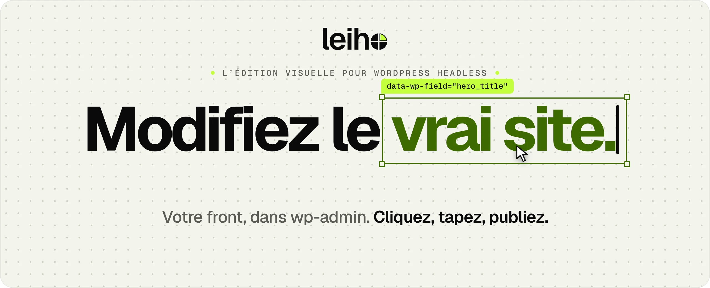
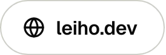
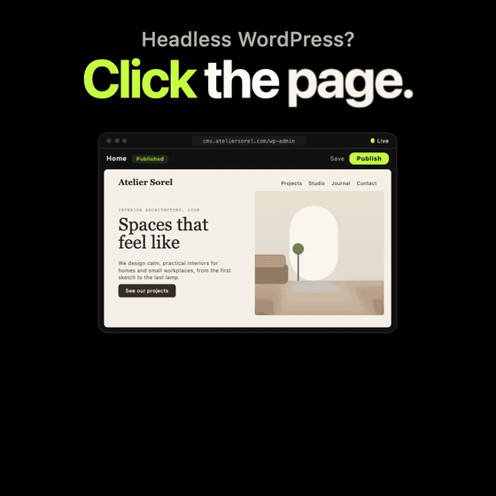
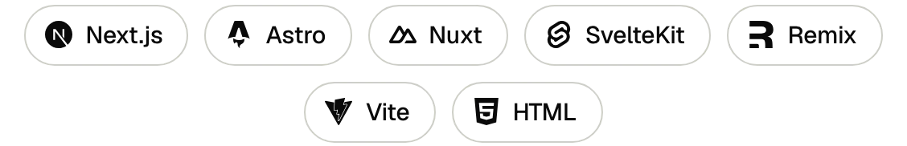
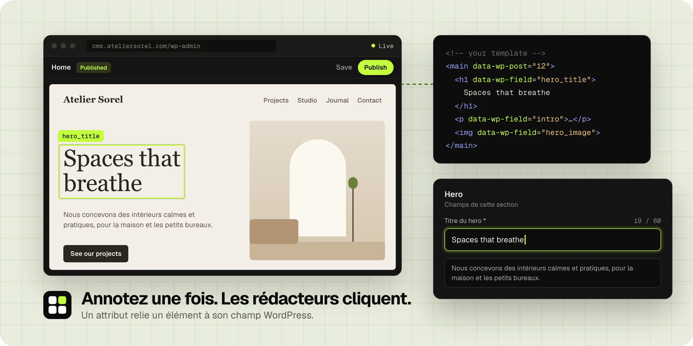

<p align="center">
  <a href="https://leiho.dev/fr">
    <picture>
      <source media="(prefers-color-scheme: dark)" srcset=".github/assets/readme/hero-fr-dark.webp">
      
    </picture>
  </a>
</p>

<p align="center">
  <strong>Modifiez le vrai site.</strong><br />
  L'édition visuelle pour WordPress headless : vos rédacteurs cliquent sur le vrai front dans wp-admin, tapent et publient.
</p>

<p align="center">
  <a href="https://leiho.dev/get/leiho.zip"></a>
  <a href="https://leiho.dev/gh"></a>
  <a href="https://leiho.dev/fr">
    <picture>
      <source media="(prefers-color-scheme: dark)" srcset=".github/assets/readme/button-site-dark.webp">
      
    </picture>
  </a>
</p>

<p align="center">
  <sub>WordPress 6.0+ et PHP 7.4+. Fonctionne avec Next.js, Astro, Nuxt, SvelteKit, Remix, Vite ou du HTML simple. Gratuit et open source, GPL-2.0-or-later. La démo tourne dans votre navigateur : sans installation ni inscription.</sub>
</p>

<p align="center">
  <a href="https://github.com/pixelersagency/leiho/releases"></a>
  <a href="https://github.com/pixelersagency/leiho/stargazers"></a>
  <a href="LICENSE"></a>
  <a href="https://www.npmjs.com/package/leiho"></a>
  
</p>

<p align="center"><a href="https://leiho.dev/gh"></a></p>

<p align="center">
  <sub><a href="README.md">English</a> · <a href="https://leiho.dev/fr/docs">Documentation</a> · <a href="CHANGELOG.md">Changelog</a> · <a href="bridge/">Paquet bridge</a> · <a href="examples/">Exemples par framework</a><br />
  <em>Leiho</em> veut dire <em>fenêtre</em> en basque. Il s’appelait Okno jusqu’à la 1.0.0-beta.11 : voir <a href="#vous-veniez-dokno">Vous veniez d’Okno</a>.</sub>
</p>

<br />

<p align="center">
  <picture>
    <source media="(prefers-color-scheme: dark)" srcset=".github/assets/readme/heading-live-fr-dark.webp">
    
  </picture>
</p>

<p align="center">Leiho charge votre vrai front dans wp-admin. Les rédacteurs cliquent sur un titre, une image ou une liste,<br />modifient le champ correspondant, et la page change pendant qu'ils tapent.</p>

<table>
  <tr>
    <td width="50%"><strong>Aperçu en direct, dans le navigateur.</strong><br />La page change à chaque frappe ; rien n'arrive dans WordPress avant <b>Enregistrer</b>. Les champs limités affichent un compteur de caractères.</td>
    <td width="50%"><strong>Annuler, brouillons, historique.</strong><br />Ctrl+Z, Ctrl+Maj+Z et Ctrl+S. Les modifications non enregistrées survivent à un onglet fermé, et chaque enregistrement est consigné avec ses valeurs avant / après et son auteur.</td>
  </tr>
  <tr>
    <td><strong>Composer les pages.</strong><br />Ajouter, déplacer, dupliquer et supprimer des sections là où vous les avez liées à un contenu flexible ou à un champ blocs de Leiho, avec les seules mises en page que vous avez définies.</td>
    <td><strong>Pas d'écrasement silencieux.</strong><br />Si quelqu'un d'autre a modifié la page entre-temps, Leiho refuse d'enregistrer par-dessus et propose de recharger.</td>
  </tr>
</table>

<br />

<p align="center">
  <picture>
    <source media="(prefers-color-scheme: dark)" srcset=".github/assets/readme/heading-frontend-fr-dark.webp">
    
  </picture>
</p>

<p align="center">Gardez votre framework, vos composants et votre hébergeur. Ajoutez un petit script, le bridge, puis marquez<br />ce que les rédacteurs peuvent modifier avec <code>data-wp-field</code>. Pas de constructeur de pages, pas de HTML libre.</p>

<p align="center">
  <picture>
    <source media="(prefers-color-scheme: dark)" srcset=".github/assets/readme/frameworks-dark.webp">
    
  </picture>
</p>

<p align="center">
  <picture>
    <source media="(prefers-color-scheme: dark)" srcset=".github/assets/readme/scene-fr-dark.webp">
    
  </picture>
</p>

<p align="center">Les apps React ajoutent un composant, <code>&lt;LeihoBridge /&gt;</code>. Les autres sites ne chargent <code>leiho-bridge.js</code> que dans l'éditeur :<br />les visiteurs ne téléchargent que quelques lignes. Les intégrations pas à pas sont dans <a href="examples/"><code>examples/</code></a>.</p>

<br />

<p align="center">
  <picture>
    <source media="(prefers-color-scheme: dark)" srcset=".github/assets/readme/heading-editors-fr-dark.webp">
    
  </picture>
</p>

<p align="center">WordPress reste l'unique source de vérité, avec ses rôles, ses brouillons, sa médiathèque et ses révisions.<br />Leiho s'ouvre en plein écran comme back-office : les rédacteurs n'ont plus besoin du reste de wp-admin.</p>

<table>
  <tr>
    <td width="50%"><strong>ACF, JetEngine ou Leiho Collections.</strong><br />Gardez vos champs ACF (gratuit ou Pro) ou vos meta boxes JetEngine tels quels, ou définissez vos types de contenu dans Leiho, stockés dans des tables typées. Un type ACF peut <a href="#importer-depuis-acf">passer à Leiho</a> un par un.</td>
    <td width="50%"><strong>Une mise en ligne adaptée à votre hébergeur.</strong><br />Contenu en direct, build hook (Vercel, Netlify, Cloudflare Pages), GitHub Actions avec suivi du build, commit de publication ou Coolify.</td>
  </tr>
  <tr>
    <td><strong>Un onglet Sécurité.</strong><br />Éditeur de fichiers coupé, erreurs de connexion qui ne révèlent pas les identifiants, tentatives limitées, adresse de connexion au choix, commentaires coupés si le site ne s'en sert pas.</td>
    <td><strong>Leiho Zero.</strong><br />Un thème vide livré avec Leiho, pour un WordPress qui ne sert que de back-office. Un bouton l'installe ; un autre remet votre thème précédent.</td>
  </tr>
</table>

<br />

<p align="center">
  <picture>
    <source media="(prefers-color-scheme: dark)" srcset=".github/assets/readme/heading-hood-fr-dark.webp">
    
  </picture>
</p>

<p align="center">Une extension WordPress, et un petit script dans votre front<br />qui ne parle qu'à wp-admin.</p>

- **Un petit bridge.** `leiho-bridge.js` est du JavaScript simple, sans dépendance, environ 8 Ko compressé (gzip). Il trouve les éléments annotés et les signale à l'éditeur.
- **`postMessage`, vérifié par origine.** Chaque message est vérifié dans les deux sens. Hors de l'iframe de l'éditeur, le bridge ne fait rien, et il ne fait jamais de requête réseau.
- **Aucun secret dans le front.** Le bridge n'appelle jamais l'API WordPress. L'édition passe par l'espace REST `leiho/v1`, avec un nonce et les capacités WordPress.
- **Une API de contenu en plus.** `/wp-json/leiho/v1/export` sert tout le contenu publié en une requête mise en cache, avec les types TypeScript de `npx leiho types`.

| Partie            | Technique                                                                                |
| ----------------- | ---------------------------------------------------------------------------------------- |
| Extension         | PHP 7.4+, WordPress 6.0+ (les outils IA demandent la 7.0+), espace REST `leiho/v1`        |
| Bridge            | JavaScript sans dépendance, paquet npm [`leiho`](bridge/) (composant React dans `leiho/react`) |
| Client de contenu | `leiho/content`, `leiho/seo`, `leiho/ai-ready` et la commande `npx leiho`, Node 18+       |
| Stockage          | Vos champs ACF, ou les tables de Leiho Collections (MySQL 5.7+, MariaDB, SQLite)          |
| Mise en ligne     | Build hooks, GitHub Actions, commit GitHub, Coolify                                      |
| Mises à jour      | Versions GitHub signées en Ed25519, vérifiées par l'extension avant installation          |

```
plugin/     Extension WordPress (PHP, GPL-2.0-or-later)
bridge/     leiho : le bridge côté front (JS sans dépendance)
examples/   Intégrations minimales : Next.js, Astro, React + Vite, HTML simple
scripts/    Empaquetage des versions
```

```bash
# Tests de l'extension (sans WordPress)
for f in plugin/tests/test-*.php plugin/tests/smoke-load.php; do php "$f" || exit 1; done

# Tests du client de contenu
cd bridge && npm test

# Reconstruire le bridge (le copie aussi dans l'extension)
cd bridge && npm run build

# Construire le zip installable dans dist/
./scripts/build-zip.sh
```

[CONTRIBUTING.md](CONTRIBUTING.md) explique l'installation et les pull requests. Une faille ? Voir [SECURITY.md](SECURITY.md).

<br />

<p align="center">
  <picture>
    <source media="(prefers-color-scheme: dark)" srcset=".github/assets/readme/heading-answers-fr-dark.webp">
    
  </picture>
</p>

<details>
<summary><strong>C'est gratuit ?</strong></summary>
<br />
Oui. L'extension et le paquet <code>leiho</code> sont gratuits et open source, sous licence GPL-2.0-or-later.
</details>

<details>
<summary><strong>Faut-il ACF ?</strong></summary>
<br />
Non. ACF (gratuit ou Pro) est facultatif. Gardez vos champs ACF ou JetEngine existants, ou définissez vos types de contenu avec <a href="#collections">Leiho Collections</a>, qui les stocke dans des tables typées. WordPress et Leiho suffisent.
</details>

<details>
<summary><strong>Mes données sont-elles enfermées ?</strong></summary>
<br />
Non. Le contenu reste dans WordPress. Les champs ACF restent des champs ACF, et Leiho n'y touche pas si vous le retirez. Les Collections Leiho sont des articles WordPress plus une table par collection, exportés en JSON par l'API de contenu, et un type importé depuis ACF peut revenir à ACF. Supprimer l'extension efface les tables des Collections, sauf si <code>define( 'LEIHO_KEEP_DATA', true );</code> figure dans <code>wp-config.php</code> ; la désactiver garde tout.
</details>

<details>
<summary><strong>Les rédacteurs peuvent-ils casser la mise en page ou le build ?</strong></summary>
<br />
Non. Ils ne modifient que les champs que vous avez annotés, et chaque valeur est vérifiée selon le type de son champ à l'enregistrement. La structure reste dans votre code : quels champs existent, quels types de sections une page peut utiliser. Un type de section n'existe qu'une fois ajouté au groupe de champs (ou au schéma Leiho) et rendu par votre front.
</details>

<details>
<summary><strong>Site statique ou rendu serveur ?</strong></summary>
<br />
Les deux. Un site rendu côté serveur affiche les changements dès l'enregistrement ; un site statique se reconstruit quand un rédacteur clique sur <b>Publier</b> (build hook, GitHub Actions, commit ou Coolify), ou tout seul après chaque modification si vous l'activez.
</details>

<details>
<summary><strong>Faut-il WPGraphQL ?</strong></summary>
<br />
Non. Gardez-le si vous l'utilisez : Leiho lit et écrit les mêmes champs ACF. Ou utilisez l'API de contenu de Leiho (<code>/leiho/v1/export</code>, une requête par build, avec les types TypeScript).
</details>

<details>
<summary><strong>Pourquoi pas des fichiers Markdown dans Git ?</strong></summary>
<br />
Si vos rédacteurs sont à l'aise pour commiter du Markdown, gardez-le. Leiho s'adresse à ceux qui connaissent déjà WordPress, ou qui préfèrent cliquer sur la page plutôt qu'apprendre Git : ils voient le vrai site pendant qu'ils écrivent, et personne n'a à relire une pull request pour corriger une faute.
</details>

<details>
<summary><strong>Qu'est-ce que ça demande comme maintenance ?</strong></summary>
<br />
Une extension WordPress, mise à jour depuis l'écran Extensions comme les autres (les mises à jour sont signées), et un petit bridge sans dépendance dans votre front.
</details>

<details>
<summary><strong>Pourquoi Leiho n'est-il pas sur WordPress.org ?</strong></summary>
<br />
Leiho se met à jour depuis ses versions GitHub, signées et vérifiées avant installation, et il embarque le thème Leiho Zero. Ni l'un ni l'autre ne rentre dans les règles du répertoire WordPress.org : Leiho est donc distribué ici. Les mises à jour apparaissent quand même dans <b>Extensions</b> comme les autres.
</details>

<details>
<summary><strong>Qu'est-ce qui manque encore ?</strong></summary>
<br />
L'interface n'existe qu'en français et en anglais. Les types de champs non pris en charge s'affichent en lecture seule. Dans un contenu de l'éditeur de blocs, seuls les blocs courants (paragraphes, titres, listes, citations, images, séparateurs) sont modifiables ; les autres restent verrouillés et reviennent intacts. Les pages et articles ne peuvent pas devenir des collections Leiho, l'adresse de connexion personnalisée ne fonctionne pas en multisite, et les outils IA demandent WordPress 7.0. <a href="https://github.com/pixelersagency/leiho/issues">Dites-nous ce qui casse.</a>
</details>

<br />

## Démarrage rapide

### 1. Installer le plugin

[Téléchargez `leiho.zip`](https://leiho.dev/get/leiho.zip) (dernière version, aussi listée sur la [page des versions](https://github.com/pixelersagency/leiho/releases)) et téléversez-le dans **Extensions → Ajouter → Téléverser**. Les versions suivantes apparaissent dans **Extensions** comme n’importe quelle mise à jour. Nécessite WordPress 6.0+ et PHP 7.4+. [ACF](https://www.advancedcustomfields.com/) (gratuit ou Pro) est facultatif : gardez vos champs ACF, ou définissez vos contenus avec [Leiho Collections](#collections).

### 2. Le relier au site

**Leiho → Réglages** : l'adresse du site, les types de contenu ouverts aux rédacteurs et le modèle d'URL de chacun (`/{slug}` par défaut ; la page d'accueil correspond à `/`).

### 3. Autoriser wp-admin à afficher le site

Le front doit envoyer cet en-tête (**Leiho → Démarrer** l'affiche avec votre domaine et le vérifie pour vous) :

```
Content-Security-Policy: frame-ancestors 'self' https://votre-wordpress.fr
```

Remplacez `https://wp.example.com` par l'origine de votre wp-admin (protocole et domaine, sans chemin). Plusieurs origines se séparent par des espaces, par exemple le WordPress de production et celui de préproduction.

<details>
<summary><b>Vercel</b> : <code>vercel.json</code></summary>

```json
{
  "headers": [
    {
      "source": "/(.*)",
      "headers": [
        { "key": "Content-Security-Policy", "value": "frame-ancestors 'self' https://wp.example.com" }
      ]
    }
  ]
}
```
</details>

<details>
<summary><b>Netlify</b> : <code>netlify.toml</code></summary>

```toml
[[headers]]
  for = "/*"
  [headers.values]
    Content-Security-Policy = "frame-ancestors 'self' https://wp.example.com"
```
</details>

<details>
<summary><b>Cloudflare Pages / Workers (fichiers statiques), Netlify</b> : <code>public/_headers</code></summary>

```
/*
  Content-Security-Policy: frame-ancestors 'self' https://wp.example.com
```

Astro, Vite, Nuxt et SvelteKit copient `public/` tel quel dans le build (`static/` pour SvelteKit).
</details>

<details>
<summary><b>Next.js</b> (tout hébergeur) : <code>next.config.mjs</code></summary>

```js
export default {
  async headers() {
    return [{
      source: '/:path*',
      headers: [{ key: 'Content-Security-Policy', value: `frame-ancestors 'self' ${process.env.WORDPRESS_URL}` }],
    }];
  },
};
```
</details>

<details>
<summary><b>nginx</b> (Coolify, un VPS…)</summary>

```nginx
add_header Content-Security-Policy "frame-ancestors 'self' https://wp.example.com" always;
```
</details>

<details>
<summary><b>Apache / .htaccess</b></summary>

```apache
Header always set Content-Security-Policy "frame-ancestors 'self' https://wp.example.com"
```
</details>

Si le site envoie déjà un `Content-Security-Policy`, ajoutez-y la directive `frame-ancestors`. L'éditeur affiche toujours un cadre vide ? Ouvrez la console du navigateur sur la page Leiho : elle nomme l'en-tête qui bloque.

### 4. Installer le bridge et annoter le balisage

**React (Next.js, Remix, Vite…)**

```bash
npm install leiho
```

```jsx
// Layout racine : app/layout.tsx, root.tsx, App.tsx…
import { LeihoBridge } from 'leiho/react';

<LeihoBridge wpOrigin="https://votre-wordpress.fr" />
```

**Autres sites (Astro, Nuxt, SvelteKit, HTML)** : copiez `leiho-bridge.js` (téléchargeable depuis **Leiho → Démarrer**) dans le dossier public, puis dans le `<head>` :

```html
<script>
  // Ne charge le bridge que dans l'éditeur : ~150 octets pour les visiteurs.
  if (window.self !== window.top) {
    var s = document.createElement('script');
    s.src = '/leiho-bridge.js';
    s.setAttribute('data-wp-origin', 'https://votre-wordpress.fr');
    document.head.appendChild(s);
  }
</script>
```

Annotez ensuite ce qui doit être modifiable :

```html
<main data-wp-post="12">
  <h1 data-wp-field="_title">À propos</h1>
  <p data-wp-field="intro">Nous fabriquons des choses.</p>
  
</main>
```

Dans wp-admin, **Leiho → Démarrer → Tester la connexion** confirme que le bridge répond. Les intégrations pas à pas par framework sont dans [`examples/`](examples/).

> **Vous travaillez avec un agent de code ?** **Leiho → Démarrer** fournit des prompts prêts à coller et le contrat d'intégration complet ([`plugin/docs/agent-instructions.md`](plugin/docs/agent-instructions.md)) pour Claude Code, Cursor, Codex, etc.

## Pourquoi

Le headless donne aux développeurs un front moderne, mais retire aux rédacteurs le « ce que je vois ». Ils remplissent des formulaires à l'aveugle, attendent un build et découvrent le résultat sur le site en ligne. Leiho leur remet le site sous les yeux, sans demander aux développeurs de changer de stack.

- **Compatible avec n'importe quel front.** Un bridge d'environ 10 Ko, sans dépendance, dialogue avec wp-admin par `postMessage`. Les apps React ont un composant d'une ligne.
- **Votre modèle de données, intact.** Leiho lit et écrit les champs ACF existants : repeaters, groupes, contenu flexible, relations, images. Les champs JetEngine aussi, tous types compris (cartes, couleurs, icônes, repeaters en champs séparés), enregistrés dans ses propres formats.
- **Rien de public.** Le bridge n'appelle jamais l'API WordPress et ne détient aucun secret. Chaque message est vérifié par son origine, des deux côtés.
- **Une mise en ligne adaptée à votre hébergement.** Contenu en direct, build hook (Vercel, Netlify, Cloudflare Pages), GitHub Actions avec suivi du build, commit de publication ou Coolify.

## Leiho, c'est le back-office

Un clic sur **Leiho** dans wp-admin et il s'ouvre en plein écran : menu WordPress, barre d'administration, pied de page et notices des autres extensions disparaissent (sur cette page seulement), remplacés par la navigation de Leiho. WordPress + Leiho suffisent, les rédacteurs n'ont jamais besoin d'en sortir.

| | |
|---|---|
| **Accueil** | Dernières modifications (avant / après), état de la connexion et des publications, raccourcis. |
| **Éditeur visuel** | Le site tel que le voient les visiteurs, modifiable sur place. |
| **Collections** | Tous les contenus en trois volets, quel que soit leur moteur : les types à gauche (pages et articles WordPress, types ACF ou du thème, collections et pages uniques Leiho, avec leur nombre d'entrées), les entrées du type choisi au milieu (recherche, filtre par statut, tri, création, duplication, mise en ligne ou retour en brouillon, corbeille et restauration), et l'entrée choisie éditée sur place à droite avec tous ses champs, y compris ceux de WordPress : contenu (éditeur de texte riche avec titres, listes, liens, citations et images de la médiathèque), extrait, adresse (slug), catégories, étiquettes et autres taxonomies publiques (pastilles avec recherche ; une nouvelle étiquette est créée à l'enregistrement), auteur, date de publication, parent et ordre, selon ce que le type prend en charge (annuler / rétablir, brouillons locaux, protection des conflits, historique), son statut, **Enregistrer**, et un lien vers l'éditeur visuel ou la page en ligne quand elle en a une. L'onglet **Champs** d'une collection Leiho ouvre le constructeur de schéma (administrateurs, voir plus bas) ; les types ACF renvoient vers ACF. |
| **Médias** | La médiathèque : grille, recherche, envoi (bouton ou glisser-déposer), texte alternatif. |
| **Publications** | L'historique des déploiements. Le bouton **Publier** de la barre du haut signale les changements pas encore publiés. |
| **Rôles** | Ce que chaque rôle WordPress voit et fait dans Leiho (administrateurs, voir [Rôles](#rôles)). |
| **Réglages** | Tout ce dont Leiho a besoin (administrateurs). |

Éditeurs et auteurs arrivent dans Leiho dès la connexion (réglage activé par défaut) ; les administrateurs gardent le tableau de bord WordPress et un lien **Retour à WordPress**. La navigation se replie, se pilote au clavier et devient un tiroir sur petit écran ; le thème clair ou sombre est partagé avec l'éditeur et gardé par utilisateur côté serveur : chaque page s'ouvre directement dans le bon thème (sombre par défaut). Les anciennes adresses (`admin.php?page=leiho-settings`, `leiho-editor`…) redirigent vers leur vue.

Un contenu écrit avec l'éditeur de blocs de WordPress n'est jamais réécrit par Leiho : son champ **Contenu** montre un aperçu en lecture seule et un lien **Ouvrir dans l'éditeur WordPress** (le serveur refuse de l'écraser), tous les autres champs de l'entrée restent modifiables. Un contenu classique est enregistré au format de l'éditeur classique.

## Annotations

Dans un framework JavaScript, laissez le paquet `leiho` écrire les attributs : `field()`, `block()` et `entry()` renvoient un objet à étaler sur l’élément (JSX, Astro, Svelte ; `v-bind` en Vue).

```jsx
import { field, block } from 'leiho';

<h1 {...field(page, 'hero_titre')}>{page.fields.hero_titre}</h1>
<section {...block(page, 'sections', i, 'Hero')}>…</section>
```

`field(page, 'intro', { html: true })` ajoute `data-leiho-apply="html"` ; `{ gallery: true }` ajoute `data-leiho-apply="gallery"` (voir [Galeries](#galeries)) ; `{ refresh: true }` ajoute `data-leiho-refresh="save"`. En HTML ou dans des gabarits serveur, écrivez à la main les attributs ci-dessous.

| Attribut | Rôle |
|---|---|
| `data-wp-post="12"` | Conteneur : ID du contenu WordPress des champs qu'il contient |
| `data-wp-field="hero_titre"` | Élément modifiable : nom du champ ACF, ou `_title` / `_thumbnail` / `_content` (le corps de l'article, avec `data-leiho-apply="html"`) |
| `data-wp-field="cartes.0.titre"` | Les chemins pointés atteignent repeaters, contenu flexible et groupes |
| `data-leiho-apply="html"` | La valeur contient du balisage : injectée en HTML filtré plutôt qu'en texte |
| `data-leiho-apply="gallery"` | Un champ galerie : un enfant par image, refait en direct sur le modèle du premier |
| `data-leiho-refresh="save"` | Pas d'aperçu en direct ; la page est rechargée après l'enregistrement |
| `data-leiho-section="Hero"` | Nomme une section dans l'arbre de structure |
| `data-leiho-layout="sections.2"` | Lie une section à une ligne de contenu flexible : ajout, déplacement, duplication, suppression |
| `data-leiho-managed="menu"` | Contenu géré ailleurs (menus, listes d'articles, WooCommerce) : un clic explique où le modifier |
| `data-leiho-edit-url="…"` | L'écran wp-admin où modifier ce contenu géré |

**Une seule règle :** affichez toujours un élément annoté, même quand sa valeur est vide. `{titre && <h2 data-wp-field="titre">…}` empêche l'édition en direct : un élément absent de la page ne peut pas être rempli.

### Galeries

L'éditeur ajoute plusieurs photos d'un coup (dans n'importe quel ordre), les réordonne en les faisant glisser et en retire. Aucun réglage de mise en page : c'est le site qui décide du rendu.

**Dans le corps d'un article** (`_content`), **Ajouter une galerie**, à côté de **Ajouter un média**, crée une galerie à l'endroit du curseur ; un clic sur une galerie permet d'en changer les photos ou de la supprimer. Elle est enregistrée comme le bloc Galerie de WordPress (`core/gallery`, un `core/image` par photo) : l'éditeur de blocs l'ouvre comme une galerie ordinaire, et une galerie faite dans l'éditeur de blocs se modifie dans Leiho. Un article classique qui reçoit une galerie est enregistré en blocs. L'API de contenu sert le bloc rendu : `figure.wp-block-gallery > figure.wp-block-image > img` (+ `figcaption` s'il y a une légende).

Pour modifier le corps dans l'éditeur visuel, annotez-le : `<div {...field(article, '_content', { html: true })} set:html={article.content} />`.

**Un champ galerie** (`gallery` d'ACF / SCF, ou de Leiho Collections) est servi comme une liste d'images, dans l'ordre choisi, chacune au format d'un champ image : `{ id, url, alt, title, mime, width, height, sizes }`. Affichez un enfant par image dans un conteneur annoté ; l'aperçu le refait en direct sur le modèle du premier enfant :

```astro
<ul class="leiho-gallery" {...field(page, 'photos', { gallery: true })}>
  {page.fields.photos.map((photo) => (
    <li></li>
  ))}
</ul>
```

**Rendu par défaut** : `import 'leiho/gallery.css'` (ou une copie) donne aux deux galeries une grille automatique de carrés, autant de colonnes que la largeur le permet (200 px minimum), et garde une photo seule à son format. Variables : `--leiho-gallery-min`, `--leiho-gallery-gap`, `--leiho-gallery-radius`, `--leiho-gallery-ratio` ; ou écrivez votre propre CSS pour `.leiho-gallery` et `.wp-block-gallery`.

### Aperçu des brouillons

Un brouillon (ou un contenu en attente, programmé ou privé) n'a pas encore de page sur le site, surtout un site statique. L'éditeur le montre dans la page du dernier contenu publié du même type, avec les valeurs du brouillon, et l'indique. Ce qui ne vient pas du contenu (une date non annotée, une liste d'articles récents) reste celui de cette page. Une page n'emprunte que la page d'une autre page du même modèle. Le filtre `leiho_preview_stand_in` choisit une autre page, ou `null` si le front affiche les brouillons à leur propre adresse. Demande le bridge 6. Le corps d'un article est prévisualisé tel que WordPress le rendra (blocs, galeries, embeds).

## Rôles

Leiho n’ajoute ni rôles ni utilisateurs : l’écran **Rôles** règle, pour chaque rôle WordPress qui modifie du contenu (Éditeur, Auteur, Contributeur, ou un rôle d’une autre extension), ce qu’il obtient dans Leiho. On part d’un profil, puis on ajuste :

| Profil | Écrans | Met le site en ligne | Par défaut pour |
|---|---|---|---|
| **Gestionnaire de contenu** | Éditeur visuel, Collections, Médias, Publication | Oui | Éditeur |
| **Rédacteur** | Éditeur visuel, Collections, Médias | Non | Auteur, Contributeur et autres rôles |
| **Aucun accès** | Accueil seulement | Non | |

Chaque rôle peut aussi être limité à certains types de contenu (un auteur qui n’écrit que le blog), perdre les outils d’IA, et passer en **mode simplifié** : rien de technique à l’écran (pas d’onglet de code HTML, pas de noms de types de champ, pas de détails de build), et le tableau de bord de WordPress ouvre Leiho. Le mode simplifié est actif dans tous les profils.

Les droits de WordPress s’appliquent toujours en plus : un auteur ne modifie que ses contenus, un contributeur ne publie pas. Les administrateurs ont toujours accès à tout, pour qu’aucun réglage ne puisse enfermer dehors qui les modifie. Les règles sont appliquées par le serveur (routes REST, outils d’IA, mise en ligne), pas seulement masquées à l’écran. Une extension de rôles (Members, User Role Editor) peut accorder une permission à un utilisateur ou un rôle avec la capability `leiho_<permission>` (`leiho_publish_site`, `leiho_use_ai`, `leiho_view_deploys`…).

## Modes de mise en ligne

| Mode | Pour | Ce que fait « Publier » |
|---|---|---|
| **Contenu en direct** | Sites qui lisent WordPress à chaque visite (SSR, ISR) | Rien : enregistrer suffit, le bouton disparaît |
| **Build hook** | Vercel, Netlify, Cloudflare Pages, toute URL de rebuild | Appelle l'URL |
| **GitHub Actions** | Builds statiques lancés par Actions | Déclenche un workflow et suit le build en direct |
| **Commit GitHub** | Hébergeurs qui déploient à chaque push | Pousse un commit vide sur la branche |
| **Coolify** | Coolify auto-hébergé | Appelle le webhook de déploiement |

La documentation complète (champs pris en charge, sécurité, extensions, développement) est dans le [README anglais](README.md).

## API de contenu

Leiho sert aussi le contenu au front : WordPress reste la seule source de vérité, le dépôt du front ne garde que le code.

```ts
import { loadLeihoContent, indexLeihoContent } from 'leiho/content';

const { data } = await loadLeihoContent( { url: 'https://cms.exemple.fr' } );
const contenu = indexLeihoContent( data );
contenu.byPath( '/services/audit' );
```

- `GET /wp-json/leiho/v1/export` : tout le contenu publié en une réponse, mis en cache, avec ETag (un build sans changement reçoit un 304). Une requête par build au lieu d'une par page : la base ne sature plus sur un mutualisé.
- Instantané : chaque chargement réussi est écrit dans `.leiho/content.json` ; si WordPress ne répond pas, le build continue avec le dernier contenu connu et le signale.
- Types : `npx leiho types --url https://cms.exemple.fr` écrit `src/leiho.d.ts`, généré depuis les groupes de champs ACF.
- Accès public par défaut (contenu publié seulement), ou restreint par jeton (`LEIHO_TOKEN`).
- Publication automatique après chaque modification, en option.
- Articles programmés : quand WordPress met en ligne un contenu programmé, Leiho publie le site dans le même passage du cron. Mais WP-Cron ne tourne que si quelqu'un charge WordPress, ce qui arrive rarement en headless. Ajoutez `define( 'DISABLE_WP_CRON', true );` dans `wp-config.php` et appelez `https://cms.exemple.fr/wp-cron.php?doing_wp_cron` toutes les 5 minutes depuis le cron de votre hébergeur (ou `wp cron event run --due-now` avec WP-CLI).
- À la première installation, WordPress est durci pour le headless : pas d'indexation du CMS, pages publiques redirigées vers le front, XML-RPC coupé, liste des utilisateurs fermée aux visiteurs.

Détails dans le [README anglais](README.md#content-api).

## Collections

Leiho Collections est un modèle de contenu intégré à Leiho, sans ACF : des **collections** (Services, Articles : plusieurs entrées) et des **singletons** (Accueil, Contact, Réglages du site : une seule entrée).

- **Chaque entrée est un contenu WordPress** (un type de contenu par collection) : rôles, brouillons, corbeille, révisions, médiathèque, extensions SEO et multilingues continuent de fonctionner.
- **Les valeurs des champs vivent dans une table par collection** (`wp_leiho_<collection>`), pas dans les métas : colonnes typées et indexées pour les champs simples, JSON pour les listes, blocs et groupes. MySQL 5.7+, MariaDB et SQLite.
- **Schéma versionné** : export et import d'un fichier `leiho.schema.json`, à garder dans le dépôt du front.
- **Migrations sûres** : renommer un champ ne coûte rien (clé stable), un changement de type copie les valeurs dans une nouvelle colonne, les colonnes retirées sont archivées, jamais supprimées. `dry_run` montre le plan avant.
- **Révisions** : restaurer une révision restaure aussi les champs.
- **Même éditeur, même API** que pour ACF : chemins pointés (`sections.2.items.1.title`), `/leiho/v1/export`, `/content` et `/types`.
- **Constructeur de schéma** dans Leiho → **Collections** : collections et pages uniques, libellés, modèle d'URL, fonctionnalités, et un éditeur de champs avec les 20 types et leurs options (choix, min / max, cibles des références, sous-champs des listes et groupes, types de blocs), réordonnés par glisser-déposer ou au clavier. La clé d'un champ est générée à partir de son nom et figée une fois appliquée : seuls le nom et le libellé changent ensuite. **Vérifier** lance la migration à blanc et liste ce qui va se passer (nouvelles colonnes, conversions, colonnes archivées) avant de rien appliquer ; les erreurs pointent le champ concerné. Colonnes archivées listées avec un bouton de purge (confirmée en tapant l'identifiant), import et export d'`leiho.schema.json` en un clic. Les entrées s'éditent ensuite dans Leiho → **Collections** (et dans l'éditeur visuel quand la collection a une URL). **+ Nouvelle collection**, en bas de la liste des types, en crée une.

### Langues

Un site multilingue n'a pas besoin d'une entrée par langue. Déclarez les langues une fois, dans Leiho → **Collections** → *Langues* ou dans le schéma (`"i18n": { "default": "en", "locales": ["en", "fr"] }`).

- **Champ par champ** : chaque champ racine est traduisible ou partagé. Texte, texte riche, lien, liste, blocs et groupe sont traduisibles par défaut ; nombres, images, dates, choix et références sont partagés. `"localized": false` (ou `true`) sur un champ, ou l'interrupteur *Traduisible* du constructeur.
- **La langue par défaut ne bouge pas** : ses valeurs restent dans la table de la collection ; les traductions sont dans une seule table `wp_leiho_l10n`, une ligne par entrée et par langue.
- **Chemins préfixés** : `/services/audit` devient `/fr/services/audit` (`/fr` pour l'accueil).
- **Repli** : ce qui n'est pas encore traduit, jusqu'à une ligne de liste ou un sous-champ, est servi dans la langue par défaut.
- **Édition** : sélecteur de langue dans l'éditeur visuel et le formulaire, avec l'état de chaque langue ; l'original s'affiche en indication dans les champs vides ; **Traduire avec l'IA** remplit les textes manquants, à relire avant d'enregistrer.
- **Agents** : `leiho/list-translations`, `leiho/get-translation`, `leiho/update-translation` (sur une entrée publiée, ne remplit que les traductions vides, comme suggestions qu’un éditeur relit et enregistre dans l’éditeur), `leiho/translate-entry`.
- **Front** : `?locale=fr` sur l'API de contenu, ou `loadLeihoContent( { url, locale: 'fr' } )` ; chaque élément traduit porte `locale` et `translations` (chemin dans chaque langue) pour le sélecteur de langue et `hreflang`.

### Importer depuis ACF

Un site ACF passe à Leiho Collections un type de contenu à la fois. Dans Leiho → **Collections**, un type ACF propose **Importer dans Leiho** (administrateurs) :

1. **Aperçu** : les groupes de champs ACF rattachés au type, ce que devient chaque champ dans Leiho (`text` → Texte, `repeater` → Liste, `flexible_content` → Blocs, `relationship` → Référence…) et ce qui n'est pas repris (champs sans équivalent comme `page_link`, `taxonomy` ou `user`, logique conditionnelle, valeurs par défaut, restrictions de médias, règles d'emplacement autres que le type, options de répéteur d'ACF Pro), avec le nombre d'entrées, de champs et de valeurs stockées.
2. **Import** : Leiho crée la collection avec les mêmes noms d'API (camelCase et tirets compris), puis copie les entrées par lots en passant par la validation de l'éditeur, avec une barre de progression. Une valeur refusée n'arrête pas l'import : elle est listée avec un lien vers l'entrée. Chaque entrée est ensuite vérifiée : le JSON servi par Leiho est comparé, champ par champ, à celui que servait ACF, et chaque écart est listé.
3. Le type est alors **servi par Leiho** : `/export`, `/content` et `/types` donnent le même JSON qu'avant (objets médias, références, lignes de répéteurs, `_layout` des blocs, texte riche rendu, choix, dates, nombres, booléens), et les chemins pointés de l'éditeur visuel fonctionnent toujours. Les groupes ACF restent en place mais ne s'appliquent plus à ce type.
4. **Revenir à ACF** (réglages de la collection) sert de nouveau les valeurs ACF et supprime la table Leiho de la collection.

Rien n'est jamais supprimé côté ACF : ni métas, ni groupe de champs, ni type de contenu. Les valeurs modifiées dans Leiho après l'import ne sont **pas** réécrites dans ACF : revenir à ACF rétablit les valeurs du jour de l'import. Un type déclaré par le thème ou une extension y reste déclaré (Leiho ne reprend que ses champs) ; un type déclaré dans l'écran **Post Types** d'ACF est enregistré par Leiho avec les mêmes réglages si ACF est désactivé. Les pages et articles ne peuvent pas devenir des collections : leurs champs ACF restent dans ACF.

API REST (administrateurs) : `GET /leiho/v1/collections/import-acf` (types et état), `GET …/import-acf/preview?post_type=ville`, `POST …/import-acf/run` (`{ "post_type": "ville" }`, un lot par appel jusqu'à `status: done`, reprise possible), `GET …/import-acf/status?post_type=ville`, `POST …/import-acf/rollback` (`{ "post_type": "ville", "confirm": "ville" }`). WP-CLI : `wp leiho acf-import list|preview|run|rollback`.

Format et API : [plugin/docs/collections-spec.md](plugin/docs/collections-spec.md) (en anglais).

## Formulaires et e-mails

Le formulaire de contact de votre front (ou de devis, de réservation, de newsletter…) envoie ses champs à WordPress, et Leiho s'occupe du reste. Tout se règle dans l'écran **Formulaires**, en trois onglets.

**Formulaires.** Créez un formulaire avec un identifiant, par exemple `contact`, et votre site envoie ses champs à `POST /wp-json/leiho/v1/forms/contact` (FormData ou JSON, sans jeton). Pour chaque formulaire : champs obligatoires, champs qui contiennent l'e-mail et le nom du visiteur, copie gardée dans WordPress, e-mail à votre équipe (destinataires, objet, texte, le visiteur en Reply-To) et confirmation au visiteur en option. Variables : `{fields}` (tous les champs remplis), `{name}`, `{email}`… (un champ), `{form}`, `{site}` et `{date}`. Champ piège `_hp` (doit rester vide) et `_elapsed` (millisecondes depuis l'affichage) contre les robots.

Réponses : 200 `{ ok: true, message }`, 400 `leiho_form_invalid` avec `data.fields` (`required` ou `email` par champ), 403 origine refusée, 404 formulaire inconnu, 429 trop de messages (5 en 10 minutes par IP), 500 rien d'envoyé ni de gardé. Protection : seuls les navigateurs sur le site, son aperçu et les adresses ajoutées peuvent envoyer ; 5 messages par 10 minutes par IP et 30 par heure par formulaire ; 50 000 caractères par message ; plus de 5 liens ou un mot de Réglages → Discussion → Clés de commentaires non autorisées : gardé à part comme spam probable, sans e-mail ; [Cloudflare Turnstile](https://developers.cloudflare.com/turnstile/) en option (400 `leiho_form_captcha` sans vérification valide) ; e-mails toujours en texte brut ; une confirmation par heure et par adresse, 20 par heure et par formulaire.

**Messages reçus.** Chaque message, avec son formulaire, ses champs et l'état de la notification. Rien n'est perdu si un e-mail finit en spam ou ne part pas.

**Envoi des e-mails.** Tous les e-mails de WordPress passent par un serveur SMTP : hôte, port, chiffrement, identifiant, mot de passe (chiffré, ou `LEIHO_SMTP_PASSWORD` dans wp-config.php), expéditeur. Un journal garde la date, le destinataire, l'objet et le résultat de chaque e-mail (jamais son contenu), avec des chiffres et un graphique sur 14 jours ; vous choisissez combien de lignes afficher (10 à 100) et combien de temps garder le journal (1, 3, 6 ou 12 mois, ou jusqu'à ce que vous le vidiez ; 3 mois par défaut), et un bouton envoie un e-mail de test. Quand un e-mail ne part pas, wp-admin l'affiche et Leiho peut prévenir un canal Slack ou une conversation Telegram : une alerte par heure au plus, sans données de visiteur, avec l'erreur et un lien.

**Qui voit quoi.** Dans Rôles, chaque profil peut voir les messages reçus, les supprimer, régler les formulaires et leurs e-mails, et lire le journal des e-mails. Le serveur SMTP, les alertes d'échec et la protection anti-spam restent aux administrateurs.

## Moteurs de recherche et assistants IA

Leiho donne à chaque site ce dont les moteurs de recherche et les assistants IA (ChatGPT, Claude, Perplexity, les réponses IA de Google) ont besoin pour le lire et le citer, à partir des champs que vous avez déjà.

**Dans WordPress** : chaque collection dit ce que sont ses entrées et quels champs les décrivent (Collections → une collection → *Recherche et IA*, ou dans le schéma) :

```json
{ "id": "doc", "seo": { "type": "TechArticle", "description": "summary", "image": "cover", "faq": "faq" }, "fields": [ … ] }
```

- `type` : le type schema.org (`WebPage` par défaut, `BlogPosting` pour les articles ; articles, FAQ, pages « à propos », contact, liste et profil, produit, service, événement, formation, logiciel, recette, personne, organisation, commerce local, lieu).
- `title`, `description`, `image` : les champs qui les portent. Sans champ de description, Leiho prend un champ nommé comme un résumé (`summary`, `intro`, `description`…), puis Yoast, Rank Math, SEOPress ou All in One SEO, puis l'extrait. L'image par défaut est l'image mise en avant.
- `faq` : une liste avec des champs `question` et `answer`, publiée comme une FAQ.
- `"llms": false` retire la collection de `llms.txt`.

Chaque contenu de l'API porte alors un bloc `seo` (`type`, `title`, `description`, `image`, `faq`, `jsonld`) dans la langue de la requête : `jsonld` contient la page, l'article ou le sujet et la FAQ en nœuds schema.org, avec dates et langue. Le filtre `leiho_seo` ajoute ce que vous seul savez (prix d'un produit, lieu d'un événement).

WordPress sert aussi, pour les fronts rendus à la demande (Next.js, Nuxt, SvelteKit…), via une réécriture de `/llms.txt` et de `/page.md` :

| Endpoint | Renvoie |
|---|---|
| `GET /wp-json/leiho/v1/llms.txt` | Le [llms.txt](https://llmstxt.org) du site : nom, description, puis chaque type de contenu avec ses entrées et leur description. `?full=1` ajoute le texte de chaque entrée, `?md=1` lie les `page.md`, `?locale=fr` dans une langue. Filtre `leiho_llms_intro`. |
| `GET /wp-json/leiho/v1/markdown?path=/docs/install` | Une entrée en Markdown, avec titre, description, adresse, langue et date, et un en-tête `Link: rel="canonical"`. |

**Côté front** (paquet `leiho`) : `leihoGraph()`, `jsonLd()` et `seoMeta()` dans `leiho/seo` construisent le graphe schema.org de la page (site, organisation, fil d'Ariane et nœuds du contenu) et les balises Open Graph. Pour un site statique, `leiho/ai-ready` écrit après le build chaque page en Markdown à côté de son HTML, `llms.txt` et `llms-full.txt` par langue, et un `sitemap.xml` avec les autres langues de chaque page (`hreflang`) et sa date :

```js
// astro.config.mjs
import { aiReady } from 'leiho/ai-ready';
export default defineConfig( { site: 'https://example.com', integrations: [ aiReady() ] } );
```

```bash
# tout autre build statique
npx leiho ai-ready --site https://example.com --dir out
```

## IA (WordPress 7.0+)

Leiho écrit avec le fournisseur d’IA configuré dans **Réglages → Connecteurs**, par le client d’IA de WordPress (`wp_ai_client_prompt()`). Leiho ne stocke aucune clé d’API et ne choisit aucun fournisseur ; sans WordPress 7.0, ou sans fournisseur capable de générer du texte, les outils d’IA n’apparaissent pas (les administrateurs ont un lien vers les connecteurs).

- **Contexte de marque** (Réglages, administrateurs) : nom, offre, public, ton, mots à privilégier et à éviter, **formulations interdites**, faits obligatoires, langue et jusqu’à trois textes d’exemple. Export / import en JSON. Chaque collection peut préciser à quoi elle sert et pour qui.
- **IA sur les champs texte** (formulaire et éditeur visuel) : Générer, Réécrire, Raccourcir, Développer, Corriger, Changer le ton, Traduire, et *Proposer* un titre ou une description SEO (champs SEO, extrait). Le contexte de marque, celui de la collection et les autres champs de l’entrée sont envoyés. La proposition s’ouvre avec les différences mot à mot ; les formulations interdites sont surlignées et un texte trop long est signalé avant d’accepter. Accepter écrit dans le champ comme une saisie : Annuler fonctionne, rien n’est enregistré avant « Enregistrer ».
- **Texte alternatif** des images (champs image, Médias), si le fournisseur lit les images.
- **Nouvelle entrée avec l’IA** dans Collections : un brief, une réponse JSON structurée selon les champs du type (texte, texte riche, listes, sections), un aperçu, puis un brouillon.
- **Capacités** pour les agents externes (adaptateur MCP, agents WordPress), catégorie `leiho` : `leiho/get-brand-context`, `leiho/list-collections`, `leiho/get-entry`, `leiho/update-entry-fields` (brouillons et entrées en attente seulement, validées comme dans l’éditeur, ne publie jamais).

## Vous veniez d’Okno

Okno s’appelle **Leiho** depuis la 1.0.0-beta.12, parce qu’un autre projet portait déjà ce nom. Contenus, réglages et front sont repris.

1. Sauvegardez la base de données.
2. Téléversez `leiho.zip` dans **Extensions → Ajouter → Téléverser**, désactivez Okno, puis activez Leiho. Si les deux sont actifs, Leiho attend et vous demande de désactiver Okno.
3. Leiho reprend les réglages, les jetons, les types de contenu et leurs valeurs, l’historique et les préférences de chaque utilisateur, puis le confirme dans wp-admin. Vous pouvez ensuite supprimer Okno : sa désinstallation ne touche pas aux données de Leiho.

Mettez d’abord le CMS à jour. Le front continue de fonctionner sans changement jusqu’à Leiho 2.0 : les routes `okno/v1`, l’en-tête `X-Okno-Token`, les attributs `data-okno-*`, le bridge d’Okno, `OKNO_URL` / `OKNO_TOKEN` et l’instantané `.okno/` sont encore compris. Le tableau de correspondance des noms est dans le [README anglais](README.md#coming-from-okno).

## Crédits / tiers

La mise en page et les styles de l'application Leiho (vue Collections en trois volets, lignes de liste, réglages des champs, boîtes de dialogue) sont en partie dérivés de [Stacki](https://github.com/flowtricks/stacki), Copyright (c) 2026 Timothy Ricks, sous licence MIT : voir [plugin/licenses/stacki-MIT.txt](plugin/licenses/stacki-MIT.txt). Les fichiers concernés le signalent dans leur en-tête.

La police Geist, utilisée par la page de connexion et dans les images de ce README, est Copyright 2024 The Geist Project Authors, sous licence SIL Open Font License 1.1 : voir [plugin/licenses/geist-OFL.txt](plugin/licenses/geist-OFL.txt). Les logos des frameworks viennent de [Simple Icons](https://simpleicons.org) (CC0).

## Licence

[GPL-2.0-or-later](LICENSE). Réalisé par [Pixelers](https://pixelers.fr).
