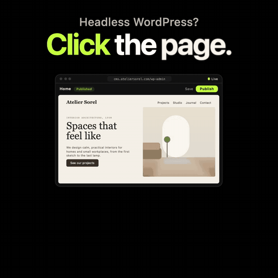

<p align="center">
  <picture>
    <source media="(prefers-color-scheme: dark)" srcset=".github/assets/leiho-logo-dark.svg">
    
  </picture>
</p>

<h1 align="center">Edit the real site.</h1>

<p align="center">
  <a href="https://leiho.dev/try"><b>▶ Try it in your browser</b></a> · no install, no sign-up<br>
  <a href="https://leiho.dev">leiho.dev</a> · <a href="https://leiho.dev/get/leiho.zip">Download leiho.zip</a> · <a href="https://leiho.dev/docs">Docs</a>
</p>

<p align="center">
  <a href="https://leiho.dev/try"></a>
</p>


**Visual editing for headless WordPress.** Your editors see the real front end — Next.js, Astro, Remix, Vite, Nuxt, SvelteKit or plain HTML — inside wp-admin. They click a heading, change it, watch it update live, save, and publish. Define your content types in Leiho, or keep your existing ACF fields: either way WordPress stays the single source of truth, with no page builder and no lock-in.

> *Leiho* means *window* in Basque — a window onto the real site. Leiho was called **Okno** until 1.0.0-beta.11: see [Coming from Okno](#coming-from-okno).

[Français](README.fr.md) · [Changelog](CHANGELOG.md) · [Bridge package](bridge/) · [Framework examples](examples/)

> **Status: 1.0.0-rc.6 (release candidate).** The interface is in English and French (it follows the WordPress site language).

---

## Why

Headless WordPress gives developers a modern front end, but it takes the "what you see" away from editors. They fill in forms blind, wait for a build, and discover the result on the live site. Leiho puts the site back in front of them, without asking developers to give up their stack.

- **Works with any front end.** A ~10 KB, dependency-free bridge talks to wp-admin through `postMessage`. React apps get a one-line component.
- **Your data model, untouched.** Leiho reads and writes the ACF fields you already have — repeaters, groups, flexible content, relationships, images.
- **Or no field plugin at all.** Leiho Collections defines content types and fields in Leiho itself, stored in typed tables. WordPress + Leiho is enough.
- **Nothing public.** The bridge never calls the WordPress API and holds no secrets. Every message is origin-checked on both sides.
- **Publishing that fits your hosting.** Live content, a build hook (Vercel, Netlify, Cloudflare Pages), GitHub Actions with live build status, a publish commit, or Coolify.

## How it works

```
┌──────────────────────── wp-admin ────────────────────────┐
│  Leiho editor                                             │
│  ┌──────────────┐  ┌───────────────────────────┐  ┌─────┐│
│  │ Pages        │  │  <iframe> your real site  │  │Field││
│  │ Structure    │  │  ┌─────────────────────┐  │  │panel││
│  │ History      │  │  │ leiho-bridge.js      │◄─┼──┤     ││
│  └──────────────┘  │  └─────────────────────┘  │  └─────┘│
│                    └───────────────────────────┘         │
│             REST (leiho/v1, nonce + capabilities)         │
└───────────────────────────┬──────────────────────────────┘
                            ▼
                     WordPress + ACF
```

1. The editor loads your front end in an iframe.
2. The bridge finds the elements you annotated with `data-wp-field` and reports them.
3. Clicking an element opens its field. Typing updates the page instantly, in the browser only.
4. **Save** writes to WordPress. **Publish** triggers your deployment (or nothing at all in live mode).

## Quick start

### 1. Install the plugin

[Download `leiho.zip`](https://github.com/pixelersagency/leiho/releases/latest/download/leiho.zip) (latest version, also listed on the [releases page](https://github.com/pixelersagency/leiho/releases)) and upload it in **Plugins → Add New → Upload Plugin**. Later versions show up in **Plugins** like any other update. Requires WordPress 6.0+ and PHP 7.4+. [ACF](https://www.advancedcustomfields.com/) (free or Pro) is optional: use your existing ACF fields, or define your content in [Leiho Collections](#collections) instead.

### 2. Point it at your site

**Leiho → Settings**: your front-end URL, the post types editors may open, and the URL pattern for each one (`/{slug}` by default; the front page maps to `/`).

### 3. Allow wp-admin to frame your site

Send this header from your front end (**Leiho → Get started** shows it with your domain filled in, and checks it for you):

```
Content-Security-Policy: frame-ancestors 'self' https://your-wordpress.example
```

Replace `https://wp.example.com` with your wp-admin's origin (scheme and host, no path). Several origins are separated by spaces, e.g. production and staging WordPress.

<details>
<summary><b>Vercel</b>: <code>vercel.json</code></summary>

```json
{
  "headers": [
    {
      "source": "/(.*)",
      "headers": [
        { "key": "Content-Security-Policy", "value": "frame-ancestors 'self' https://wp.example.com" }
      ]
    }
  ]
}
```
</details>

<details>
<summary><b>Netlify</b>: <code>netlify.toml</code></summary>

```toml
[[headers]]
  for = "/*"
  [headers.values]
    Content-Security-Policy = "frame-ancestors 'self' https://wp.example.com"
```
</details>

<details>
<summary><b>Cloudflare Pages / Workers static assets, Netlify</b>: <code>public/_headers</code></summary>

```
/*
  Content-Security-Policy: frame-ancestors 'self' https://wp.example.com
```

`public/` is copied as is into the build output by Astro, Vite, Nuxt and SvelteKit (`static/` for SvelteKit).
</details>

<details>
<summary><b>Next.js</b> (any host): <code>next.config.mjs</code></summary>

```js
export default {
  async headers() {
    return [{
      source: '/:path*',
      headers: [{ key: 'Content-Security-Policy', value: `frame-ancestors 'self' ${process.env.WORDPRESS_URL}` }],
    }];
  },
};
```
</details>

<details>
<summary><b>nginx</b> (Coolify, a VPS…)</summary>

```nginx
add_header Content-Security-Policy "frame-ancestors 'self' https://wp.example.com" always;
```
</details>

<details>
<summary><b>Apache / .htaccess</b></summary>

```apache
Header always set Content-Security-Policy "frame-ancestors 'self' https://wp.example.com"
```
</details>

If the site already sends a `Content-Security-Policy`, add the `frame-ancestors` directive to it. The editor still shows a blank frame? Open the browser console on the Leiho page: it names the header that blocked it.

### 4. Add the bridge and annotate your markup

**React (Next.js, Remix, Vite…)**

```bash
npm install leiho
```

```jsx
// Root layout: app/layout.tsx, root.tsx, App.tsx…
import { LeihoBridge } from 'leiho/react';

<LeihoBridge wpOrigin="https://your-wordpress.example" />
```

**Any other site (Astro, Nuxt, SvelteKit, HTML)**: copy `leiho-bridge.js` (downloadable from **Leiho → Get started**) to your public folder and add to `<head>`:

```html
<script>
  // Loads the bridge only inside the editor: visitors get ~150 bytes, not 10 KB.
  if (window.self !== window.top) {
    var s = document.createElement('script');
    s.src = '/leiho-bridge.js';
    s.setAttribute('data-wp-origin', 'https://your-wordpress.example');
    document.head.appendChild(s);
  }
</script>
```

Then annotate what should be editable:

```html
<main data-wp-post="12">
  <h1 data-wp-field="_title">About us</h1>
  <p data-wp-field="intro">We build things.</p>
  
</main>
```

Back in wp-admin, **Leiho → Get started → Test the connection** confirms that the bridge answers. You're done. Step-by-step setups for each framework are in [`examples/`](examples/).

> **Using a coding agent?** **Leiho → Get started** gives you ready-to-paste prompts and the full integration contract ([`plugin/docs/agent-instructions.md`](plugin/docs/agent-instructions.md)) for Claude Code, Cursor, Codex and the like.

## Annotations

In a JavaScript framework, let the `leiho` package write the attributes: `field()`, `block()` and `entry()` return an object to spread on the element (JSX, Astro, Svelte; `v-bind` in Vue).

```jsx
import { field, block } from 'leiho';

<h1 {...field(page, 'hero_title')}>{page.fields.hero_title}</h1>
<section {...block(page, 'sections', i, 'Hero')}>…</section>
```

`field(page, 'intro', { html: true })` adds `data-leiho-apply="html"`; `{ refresh: true }` adds `data-leiho-refresh="save"`. In plain HTML or server templates, write the attributes below by hand.

| Attribute | Purpose |
|---|---|
| `data-wp-post="12"` | Container: the WordPress post ID for the fields inside |
| `data-wp-field="hero_title"` | Editable element: ACF field name, or `_title` / `_thumbnail` |
| `data-wp-field="cards.0.title"` | Dotted paths reach into repeaters, flexible content and groups |
| `data-leiho-apply="html"` | The value contains markup (an accent `<span>` in a heading): inject filtered HTML instead of text |
| `data-leiho-refresh="save"` | No live preview for this field; reload the page after saving (complex WYSIWYG rendering) |
| `data-leiho-section="Hero"` | Name a section in the Structure tree |
| `data-leiho-layout="sections.2"` | Bind a section to a flexible content row, so editors can add, move, duplicate and remove it |
| `data-leiho-managed="menu"` | Content managed elsewhere (menus, post lists, WooCommerce): clicking explains where to edit it |
| `data-leiho-edit-url="…"` | The wp-admin screen for that managed content |

**One rule:** always render an annotated element, even when its value is empty. `{title && <h2 data-wp-field="title">…}` breaks live editing, because an element missing from the page can't be filled in. Leiho flags such fields as "not on this page".

Client-side navigation (React Router, Next.js links, `history.pushState`) and re-renders are handled: the bridge re-scans the page and keeps unsaved edits applied.

## Supported fields

- **Content**: text, textarea, WYSIWYG, number, range, URL, email, oEmbed, page link, link, select, true/false, date, date-time, time.
- **Media**: image (with crop-ratio warnings), file, gallery.
- **Relations**: post object, relationship, taxonomy.
- **Containers**: repeater, group, clone, flexible content, nested freely.
- **Native**: title and featured image.

Other field types show up read-only, with a link to the classic WordPress editor.

## Leiho is the back office

Click **Leiho** in wp-admin and it opens full screen: the WordPress menu, admin bar, footer and other plugins' notices are gone (on this page only), replaced by Leiho's own navigation. Install WordPress and Leiho, and editors never need to leave it.

| | |
|---|---|
| **Home** | Recent changes with before / after values, connection and publishing status, quick links. |
| **Visual editor** | The site as visitors see it, editable in place. |
| **Collections** | All your content in three panes, whatever its engine: content types on the left (WordPress pages and posts, ACF or theme post types, Leiho collections and single pages, with their entry counts), the entries of the selected type in the middle (search, status filter, sort, create, duplicate, publish or unpublish, trash and restore), and the selected entry edited in place on the right with every field — including WordPress's own: content (rich text editor with headings, lists, links, quotes and images from the media library), excerpt, URL slug, categories, tags and other public taxonomies (chips with search; new tags are created on save), author, publish date, parent and order, depending on what the type supports — (undo / redo, local drafts, conflict protection, history), its status, **Save**, and a link to the visual editor or the live page when it has one. The **Fields** tab of a Leiho collection opens the schema builder (administrators, see below); ACF types point to ACF and offer **Import into Leiho** (see [Import from ACF](#import-from-acf)). |
| **Media** | The media library: grid, search, upload (button or drag and drop), alternative text. |
| **Publishing** | Deployment history. The **Publish** button in the top bar shows when changes aren't published yet. |
| **Settings** | Everything Leiho needs (administrators). |

Editors and authors land in Leiho right after logging in (a setting, on by default); administrators keep the WordPress dashboard and get a **Back to WordPress** link. The navigation collapses, works with the keyboard, and becomes a drawer on small screens; the light or dark theme is shared with the editor and remembered per user on the server, so every page opens directly in it (dark by default). Old addresses (`admin.php?page=leiho-settings`, `leiho-editor`, …) redirect to their view.

Content written with the WordPress block editor is never rewritten by Leiho: its **Content** field shows a read-only preview and an **Open in the WordPress editor** link (the server refuses to overwrite it), while every other field of the entry stays editable. Classic content is saved in the classic editor's format.

## What editors get

- Live preview while typing, with character counters where fields have a limit.
- Undo / redo (Ctrl+Z, Ctrl+Shift+Z) and Ctrl+S to save.
- Local drafts: unsaved changes survive a closed tab, and are offered back on return.
- Page composition: add, reorder, duplicate and remove flexible content blocks.
- Create, duplicate and trash pages without leaving the editor, and change their status (draft, pending review, published, private) from the toolbar.
- Conflict protection: if someone else changed the page meanwhile, Leiho refuses to overwrite it and offers to reload.
- Change history: every saved change, with its before and after values and its author.
- Deep links: "Edit with Leiho" in the admin bar opens the current page.

## Publishing modes

| Mode | For | What Publish does |
|---|---|---|
| **Live content** | Sites that fetch WordPress at request time (SSR, ISR) | Nothing to publish: saving is enough, the button is hidden |
| **Build hook** | Vercel, Netlify, Cloudflare Pages, any rebuild URL | POSTs to the hook |
| **GitHub Actions** | Static builds run in Actions | Dispatches a workflow and follows the run live |
| **GitHub commit** | Hosts that deploy on every push | Pushes an empty commit to the branch |
| **Coolify** | Self-hosted Coolify | Calls the deployment webhook |

Tokens are encrypted in the database with a key derived from your WordPress salts. GitHub settings are checked when saved: repository, branch, workflow and token expiry.

Publishing can also be automatic: tick **Publish on its own after each change** and Leiho deploys once the edits stop (60 s by default), changes made in wp-admin included. Nothing to set up on the server: the editor shows a discreet countdown and publishes when it runs out, or right away if the client closes the tab; any open wp-admin tab publishes through the Heartbeat once the delay has passed; WP-Cron is the fallback when nobody is logged in. Whatever fires first, one batch of changes gives one deployment, and a build already running or the minimum delay between deployments only postpones it.

## Content API

Leiho also serves your content to the front end, so WordPress is the only source of truth and the front-end repository holds code, not content.

```ts
// astro.config / build script — Node 18+
import { loadLeihoContent, indexLeihoContent } from 'leiho/content';
import type { LeihoExport, Page } from './src/leiho'; // npx leiho types

const { data } = await loadLeihoContent( { url: 'https://cms.example.com' } );
const content = indexLeihoContent( data as LeihoExport );
const home = content.byPath( '/' ) as Page;
home.fields.hero_title; // typed
```

| Endpoint | Returns |
|---|---|
| `GET /wp-json/leiho/v1/export` | Every published item of the Leiho content types, in one response. Cached until something changes, with an `ETag` (an unchanged build gets a `304`). |
| `GET /wp-json/leiho/v1/content?type=&path=&slug=` | A filtered, paginated list. |
| `GET /wp-json/leiho/v1/content/{id}` | One item (drafts for logged-in editors). |
| `GET /wp-json/leiho/v1/types` | TypeScript declarations of exactly that JSON, generated from your ACF field groups. |

Each item carries `id`, `type`, `slug`, `path` (the front-end path from your URL settings), `title`, dates, `excerpt`, rendered `content`, `featured_image`, `terms` and `fields`. Fields are keyed by name and already shaped for a front end: an image is `{ id, url, alt, width, height, sizes }`, a relation is `{ id, type, slug, title, path }`, a WYSIWYG is rendered HTML, a flexible content row has a `_layout`.

- **One request per build** instead of one per page: no more "Error establishing a database connection" on shared hosting.
- **Snapshot fallback**: every successful load is written to `.leiho/content.json`. If WordPress doesn't answer, the build carries on with the last known content and says so (`fallback: 'error'` to fail instead).
- **Types**: `npx leiho types --url https://cms.example.com` writes `src/leiho.d.ts`. Regenerate it when you change fields.
- **Access**: public by default (published content only, which is public anyway). Switch to *Restricted* in the settings and set `LEIHO_TOKEN` in the build environment.
- **Caching**: Leiho plugs into the caches the site already has (Settings → *Content API* → *Cache*, on by default).
  - With a persistent object cache (Redis Object Cache, Memcached, LiteSpeed, W3 Total Cache…), the export, single items, path lookups and the types live in the WordPress object cache (group `leiho`). Invalidation is O(1): every change switches to a new cache generation instead of deleting keys. Without one, Leiho keeps its own copy of the export in a non-autoloaded option and writes nothing else to the database.
  - Every endpoint sends an `ETag` and `Cache-Control: public, max-age=0, must-revalidate`, and answers `304` to a matching `If-None-Match`. In restricted mode, for logged-in users and for drafts, responses are `private` (and LiteSpeed is told not to cache them).
  - When served content changes, Leiho purges the content API from the page caches it finds, once per request: LiteSpeed (by tag and URL, Hostinger included), WP Rocket and W3 Total Cache and WP Super Cache (by URL when they can), SiteGround, WP Fastest Cache, Cloudflare, Breeze, Nginx Helper. Hook `leiho_purge_caches` to purge anything else (a CDN, a reverse proxy); `leiho_purge_urls` changes the URLs.
  - *Clear the content cache* in the settings does all of this on demand.

### WordPress as a back office

On a new install, Leiho also hardens WordPress for headless use (Settings → *WordPress as a back office*): no indexing of the CMS (noindex header, `robots.txt`, no sitemap), public WordPress pages redirect to the same page on the front end, XML-RPC off, `/wp/v2/users` closed to visitors. wp-admin, login, the REST API and draft previews keep working. Sites updating from an earlier version keep their behavior until you tick the options.

## Collections

Leiho Collections is a content model built into Leiho: "Strapi or Webflow collections inside WordPress", without ACF. A **collection** has many entries (Services, Articles); a **singleton** has exactly one (Home, Contact, Site settings).

- **Entries are WordPress posts** (one post type per collection): roles, drafts, scheduling, trash, revisions, the media library, SEO and multilingual plugins keep working.
- **Field values live in one table per collection** (`wp_leiho_<collection>`), one row per entry, not in postmeta: typed, indexed columns for scalar fields, JSON for lists, blocks and groups. MySQL 5.7+, MariaDB and the SQLite drop-in.
- **Field types**: text, rich text, code, number, boolean, date, date-time, select (single or multiple), slug, email, URL, color, image, file, gallery, link, reference (to another collection, one or many), list, blocks and group, nested freely. A text is stored as typed (`<`, `&` and surrounding spaces kept, HTML tags removed) and served as plain text: escape it when you render it, as frameworks do by default. A code field also keeps HTML tags; render it as text too.
- **Schema as code**: export the schema to `leiho.schema.json`, keep it in your front-end repository, import it on another site.
- **Safe migrations**: renaming a field is free (fields have a stable `key`), a type change copies values into a new column, and removed or retyped columns are archived, never dropped. `dry_run` shows the plan first.
- **Revisions** include field values: restoring a revision restores the fields too.
- **Same editor, same API**: entries are edited in the visual editor with the same dotted paths as ACF (`sections.2.items.1.title`), and served by `/leiho/v1/export`, `/content` and `/types` like any other content. ACF keeps working alongside.

```json
{
  "leiho": "collections",
  "version": 1,
  "collections": [
    { "id": "service", "label": "Services", "singular_label": "Service", "path": "/services/{slug}", "fields": [
      { "name": "price", "type": "number", "min": 0 },
      { "name": "faq", "type": "list", "fields": [
        { "name": "question", "type": "text", "required": true },
        { "name": "answer", "type": "richtext" }
      ] },
      { "name": "related", "type": "reference", "to": ["service"], "multiple": true, "max": 3 }
    ] }
  ]
}
```

| Endpoint (administrators) | |
|---|---|
| `GET /wp-json/leiho/v1/collections` | Schema and table state (archived columns included). |
| `POST /wp-json/leiho/v1/collections/import?dry_run=1` | Plan the migration to an `leiho.schema.json`; without `dry_run`, apply it. |
| `GET /wp-json/leiho/v1/collections/export` | The current `leiho.schema.json`. |
| `POST`, `PUT`, `DELETE /wp-json/leiho/v1/collections/{id}` | Create, replace or remove one collection (data is kept). |

From PHP: `Leiho_Collections::import( $json )`, `Leiho_Collections::save_entry( $post_id, array( 'price' => 120 ) )`, `Leiho_Collections::entry( 'home' )`. The format is documented in [plugin/docs/collections-spec.md](plugin/docs/collections-spec.md).

**Schema builder.** Leiho → **Collections** builds the same schema without writing JSON: collections and single pages, labels, URL pattern, built-in features, and a field editor with all 20 types and their options (choices, min / max, reference targets, sub-fields of lists and groups, block types of a blocks field), reordered by drag and drop or with the keyboard. Field keys are generated from the name and fixed once applied; only the name and the label change afterwards. **Review** runs the migration as a dry run and lists what will happen (new columns, conversions, archived columns) before anything is applied; validation errors point at the field concerned. Archived columns are listed with a purge button (type the collection id to confirm), and `leiho.schema.json` is one click away for import and export. Entries are then edited in Leiho → **Collections** (and in the visual editor when the collection has a URL). **+ New collection** at the bottom of the list of types starts a new one.

### Languages

A multilingual site doesn't need one entry per language. Declare the languages once, in Leiho → **Collections** → *Languages* or in the schema:

```json
{ "leiho": "collections", "version": 1, "i18n": { "default": "en", "locales": ["en", "fr", "de"] }, "collections": [ … ] }
```

- **Field by field.** Each root field is translatable or shared. Text, rich text, link, list, blocks and group are translatable by default; numbers, images, dates, choices and references are shared. Set `"localized": false` (or `true`) on a field, or use the *Translatable* switch in the builder.
- **The default language doesn't move.** Its values stay in the collection's table; translations are stored in one `wp_leiho_l10n` table, one row per entry and language. Removing a language keeps what was written.
- **Paths are prefixed**: `/services/audit` in English is `/fr/services/audit` in French (`/fr` for the home page).
- **Fallback**: anything not translated yet, down to one row of a list or one sub-field, is served in the default language.
- **Editing**: a language switch in the visual editor and the entry form, with each language's state (*not translated*, *partly translated*, *original changed*). The original shows as a hint in empty fields. **Translate with AI** fills the missing texts as edits to review.
- **Agents**: `leiho/list-translations`, `leiho/get-translation`, `leiho/update-translation`, `leiho/translate-entry` (see AI below).
- **Front end**: `?locale=fr` on the content API, or `loadLeihoContent( { url, locale: 'fr' } )`. Translated items carry `locale` and `translations` (`{ en: '/services/audit', fr: '/fr/services/audit' }`) for language switchers and `hreflang`.

```ts
const [ en, fr ] = await Promise.all( [ 'en', 'fr' ].map( ( locale ) => loadLeihoContent( { url, locale } ) ) );
```

### Import from ACF

An existing ACF site can move to Leiho Collections one content type at a time. In Leiho → **Collections**, an ACF type has **Import into Leiho** (administrators):

1. **Preview**: every ACF field group attached to the type, what each field becomes in Leiho (`text` → Text, `repeater` → List, `flexible_content` → Blocks, `relationship` → Reference…), and what doesn't carry over (fields without an equivalent such as `page_link`, `taxonomy` or `user`, conditional logic, default values, media restrictions, location rules other than the content type, ACF Pro repeater options), with the number of entries, fields and stored values.
2. **Import**: Leiho creates the collection with the same API names (camelCase and hyphenated names included), then copies the entries in batches through the editor's validation, with a progress bar. A refused value doesn't stop the import: it is listed with a link to the entry. Each entry is then checked: the JSON Leiho serves is compared, field by field, with what ACF served, and any difference is listed.
3. The type is now **served by Leiho**: `/export`, `/content` and `/types` give the same JSON as before (media objects, references, repeater rows, `_layout` of blocks, rendered rich text, choices, dates, numbers, booleans), and the visual editor's dotted paths keep working. The ACF field groups stay in place but no longer apply to this type.
4. **Go back to ACF** (in the collection's settings) serves the ACF values again and deletes the Leiho table of the collection.

Nothing is ever deleted from ACF: no postmeta, no field group, no post type. Values edited in Leiho after the import are **not** written back to ACF; going back restores the values of the import day. A content type registered by the theme or a plugin stays registered there (Leiho only takes over its fields); one declared in ACF's **Post Types** screen is registered by Leiho with the same settings if ACF is deactivated. Pages and posts can't become collections: their ACF fields stay in ACF.

| Endpoint (administrators) | |
|---|---|
| `GET /wp-json/leiho/v1/collections/import-acf` | Content types with ACF fields, their import state, and the field groups attached to no content type (options pages…). |
| `GET /wp-json/leiho/v1/collections/import-acf/preview?post_type=ville` | The preview above, and the collection that would be created. |
| `POST /wp-json/leiho/v1/collections/import-acf/run` | `{ "post_type": "ville" }`: the first call creates the collection, each next call copies a batch (25 entries, filter `leiho_acf_import_batch`) and returns the progress, failures and differences, until `status` is `done`. An interrupted import resumes where it stopped. |
| `GET /wp-json/leiho/v1/collections/import-acf/status?post_type=ville` | Progress and report. |
| `POST /wp-json/leiho/v1/collections/import-acf/rollback` | `{ "post_type": "ville", "confirm": "ville" }`: back to ACF. |

With WP-CLI: `wp leiho acf-import list`, `wp leiho acf-import preview ville`, `wp leiho acf-import run ville`, `wp leiho acf-import rollback ville --yes`.

## Search engines and AI assistants

Leiho gives every site what search engines and AI assistants (ChatGPT, Claude, Perplexity, Google's AI answers) need to read it and quote it, from fields you already have.

**In WordPress**: each Collection says what its entries are and which fields describe them (Collections → a collection → *Search and AI*, or in the schema):

```json
{ "id": "doc", "seo": { "type": "TechArticle", "description": "summary", "image": "cover", "faq": "faq" }, "fields": [ … ] }
```

- `type`: the schema.org type (`WebPage` by default, `BlogPosting` for posts; articles, FAQ, about, contact, listing and profile pages, product, service, event, course, software, recipe, person, organization, local business, place).
- `title`, `description`, `image`: the fields that hold them. Without a description field, Leiho takes one named like a summary (`summary`, `intro`, `description`…), then Yoast, Rank Math, SEOPress or All in One SEO, then the excerpt. The image defaults to the featured image.
- `faq`: a list with `question` and `answer` fields, published as an FAQ.
- `"llms": false` keeps the collection out of `llms.txt`.

Every item of the content API then carries a `seo` block (`type`, `title`, `description`, `image`, `faq`, `jsonld`) in the language of the request: `jsonld` holds the page, the article or subject and the FAQ as schema.org nodes, with dates and language. Hook `leiho_seo` to add what only you know (a product's price, an event's place).

Also served by WordPress, for front ends rendered on request (Next.js, Nuxt, SvelteKit…), through a rewrite of `/llms.txt` and `/page.md`:

| Endpoint | Returns |
|---|---|
| `GET /wp-json/leiho/v1/llms.txt` | The site's [llms.txt](https://llmstxt.org): name, description, then each content type with its entries and their description. `?full=1` adds the full text of every entry, `?md=1` links to `page.md`, `?locale=fr` in a language. Filter `leiho_llms_intro`. |
| `GET /wp-json/leiho/v1/markdown?path=/docs/install` | One entry as Markdown, with its title, description, address, language and date, and a `Link: rel="canonical"` header. |

**On the front end** (`leiho` package):

```ts
import { leihoGraph, jsonLd, seoMeta } from 'leiho/seo';

const graph = leihoGraph( {
  url: 'https://example.com/docs/install',
  item,                                                   // item.seo.jsonld from WordPress
  site: { url: 'https://example.com', name: 'Example', locales: [ 'en', 'fr' ] },
  organization: { name: 'Example Inc.', logo: '/logo.png', sameAs: [ 'https://github.com/example' ] },
  breadcrumbs: [ { name: 'Docs', url: '/docs' }, { name: 'Install' } ],
} );
// <script type="application/ld+json" set:html={ jsonLd( graph ) } />
const { title, description, meta } = seoMeta( item, { url, siteName: 'Example' } ); // description, Open Graph
```

A static build gets every page as Markdown next to its HTML (`docs/install.md`), `llms.txt` and `llms-full.txt` per language, and a `sitemap.xml` with each page's other languages (`hreflang`) and date, read from the pages themselves:

```js
// astro.config.mjs
import { aiReady } from 'leiho/ai-ready';
export default defineConfig( { site: 'https://example.com', integrations: [ aiReady() ] } );
```

```bash
# any other static build (Next.js export, Nuxt generate, SvelteKit, Eleventy, Hugo…)
npx leiho ai-ready --site https://example.com --dir out
```

The Markdown comes from each page's `<main>`; elements with `aria-hidden="true"`, `data-md-skip`, `svg`, `canvas`, navigation and buttons are left out. Options: `locales`, `intro` and `sections` (llms.txt text and headings per language), `optional`, `exclude`, `skipClasses`, `selector`, `sitemap: false`. To answer `Accept: text/markdown` on the page's own address, rewrite to `page.md` on the server (nginx: `map $http_accept`).

## AI (WordPress 7.0+)

Leiho writes with the AI provider the site configured in **Settings → Connectors**, through WordPress's own AI client (`wp_ai_client_prompt()`). Leiho stores no API key and picks no provider; without WordPress 7.0, or without a provider that generates text, the AI tools simply don't show (administrators get a link to the connectors).

- **Brand context** (Settings, administrators): brand name, offer, audience, tone of voice, words to prefer and avoid, **forbidden claims**, mandatory facts, language and up to three sample texts. Export / import as JSON. Each collection can add its purpose and readers.
- **AI on text fields** (entry form and visual editor): Generate, Rewrite, Shorten, Expand, Fix, Change the tone, Translate, and *Suggest* a search title or description on SEO-like fields and the excerpt. The brand context, the collection's context and the entry's other fields are sent along. The proposal opens as a word-level diff; forbidden claims are highlighted and a too-long text is flagged before you accept. Accepting writes into the field like typing: undo works, nothing is saved until you save.
- **Alternative text** for image fields and in Media, when the provider reads images.
- **New entry with AI** in Collections: a brief, structured JSON output matching the type's fields (text, rich text, lists, blocks), a preview, then a draft.
- **Abilities** for external agents (MCP adapter, WordPress agents), category `leiho`: `leiho/get-brand-context`, `leiho/list-collections`, `leiho/get-entry`, `leiho/update-entry-fields` (drafts and pending entries only, validated like the editor, never publishes).
- **Translation**: *Translate with AI* in the editor (missing texts, as edits to review), and for agents `leiho/list-translations`, `leiho/get-translation`, `leiho/update-translation` (on published entries, fills empty translations as suggestions an editor reviews and saves in the editor, never replaces existing ones; anything on drafts) and `leiho/translate-entry` (the site's AI, `save` optional). REST: `POST leiho/v1/ai/translate` (`post_id`, `locale`, `mode`: `missing` or `all`).
- REST: `leiho/v1/ai/status`, `ai/field`, `ai/alt`, `ai/entry`, `ai/entry/create`, `ai/brand`, `ai/collections/{type}` (nonce, capability, size limits, per-user rate limit). Filters: `leiho_ai_capability` (default `edit_posts`), `leiho_ai_rate_limit` (20 requests a minute), `leiho_ai_timeout` (60 s), `leiho_ai_status`, `leiho_ai_ability_statuses`. Each AI action is logged in the change log (who, field, action), never the prompt.

## Coming from Okno

Okno was renamed **Leiho** in 1.0.0-beta.12, because another project already used the name. Your content, settings and front end are carried over.

1. Back up the database.
2. Upload `leiho.zip` in **Plugins → Add New → Upload Plugin**, deactivate Okno, then activate Leiho. If both are active, Leiho waits and asks you to deactivate Okno.
3. Leiho takes over Okno's settings, tokens, content types and their values, change history and per-user preferences, then confirms it in wp-admin. You can then delete Okno: its uninstall leaves Leiho's data alone.

Update the CMS first. Your front end keeps working unchanged until Leiho 2.0: the `okno/v1` REST routes, the `X-Okno-Token` header, `data-okno-*` attributes, the Okno bridge, `OKNO_URL` / `OKNO_TOKEN` and the `.okno/` snapshot are still understood, and `okno_*` hooks still run (with a deprecation notice under `WP_DEBUG`). Switch when convenient:

| Okno | Leiho |
|---|---|
| `npm i @pixelersagency/okno-bridge` | `npm i leiho` |
| `initOknoBridge`, `OknoBridge`, `loadOknoContent` | `initLeihoBridge`, `LeihoBridge`, `loadLeihoContent` |
| `okno-bridge.js` | `leiho-bridge.js` |
| `data-okno-section`, `data-okno-layout`… | `data-leiho-section`, `data-leiho-layout`… |
| `/wp-json/okno/v1/…`, `X-Okno-Token` | `/wp-json/leiho/v1/…`, `X-Leiho-Token` |
| `npx okno pull`, `OKNO_URL`, `OKNO_TOKEN`, `.okno/` | `npx leiho pull`, `LEIHO_URL`, `LEIHO_TOKEN`, `.leiho/` |
| `okno.schema.json`, `okno_*` hooks, `OKNO_KEEP_DATA` | `leiho.schema.json`, `leiho_*` hooks, `LEIHO_KEEP_DATA` |

## FAQ

**Can editors break the layout or the build?**
No. Editors only change the fields you annotated, and every value is checked against its field type on save. The structure stays in your code: which fields exist, and which section types a page may use. Editors can add, move, duplicate and remove sections only where you bound them to flexible content (or a Leiho blocks field), and only with the layouts you defined. There is no free HTML and no page builder, so content can't produce markup your components don't expect.

**What about sections my components don't handle yet?**
A section type exists only once you add it to the field group (or the Leiho schema) and render it in your front end. Until then editors can't pick it.

**Why not Markdown files in Git?**
If your editors are happy committing Markdown, keep that. Leiho is for people who already know WordPress, or would rather click on the page than learn Git: they see the real site while they type, and nobody has to review a pull request to fix a typo.

**What does it take to maintain?**
One WordPress plugin, updated from the Plugins screen like any other (updates are signed), and a ~10 KB bridge in your front end with no dependencies. Content stays in WordPress: ACF fields stay ACF fields and are never touched if you remove Leiho. Leiho Collections are regular posts plus one table per collection, exported as JSON by the content API; deleting the plugin drops those tables unless `define( 'LEIHO_KEEP_DATA', true );` is set in `wp-config.php` (deactivating keeps everything).

**Do I need WPGraphQL?**
No. Keep it if you use it: Leiho reads and writes the same ACF fields. Or use Leiho's content API (`/leiho/v1/export`, one request per build, with TypeScript types).

**Static site or server-rendered?**
Both. Server-rendered sites show changes on save; static sites rebuild when an editor clicks **Publish** (build hook, GitHub Actions, a commit, or Coolify).

**Is it free?**
Yes, GPL-2.0.

## Security

- Editing routes check a nonce and `edit_post` on the content. The content API only serves published items of the Leiho content types; it can require a token (compared in constant time, sent in `X-Leiho-Token`). Publishing requires `publish_pages` (filter `leiho_deploy_capability`), settings require `manage_options`.
- The bridge is inert outside the editor iframe and checks the origin of every message, in both directions. It makes no network request.
- Values are sanitized per field type on write. `required` and `maxlength` are enforced server side. Attachments and related posts are checked for read access.
- Use a fine-grained GitHub token limited to the deployment repository (`Actions: write`, or `Contents: write` for the commit mode).

Found a vulnerability? See [SECURITY.md](SECURITY.md).

## Extending

- **Other field plugins**: implement `Leiho_Adapter_Interface` and register it with the `leiho_adapters` filter (Meta Box, JetEngine, Pods…).
- **Other deployment targets**: implement `Leiho_Deploy_Driver_Interface` and plug it in with `leiho_deploy_driver`.
- **WYSIWYG preview**: `leiho_wysiwyg_render` replaces `wpautop()` with your front end's actual rendering.
- **Content API**: `leiho_content_item` adds or removes data on each item (SEO, author…), `leiho_content_post_types` changes the served types, `leiho_content_html` the rendered HTML. `leiho_content_cache` turns the cache on or off, `leiho_content_cache_control` changes the `Cache-Control` header, `leiho_purge_third_party_caches` (false) skips the built-in purges. An adapter implementing `Leiho_Content_Adapter_Interface` feeds the content API and the types.
- **Automatic publishing**: the `leiho_content_changed` action fires when served content changes.

## Repository layout

```
plugin/     WordPress plugin (PHP, GPL-2.0-or-later)
bridge/     leiho — the front-end bridge (vanilla JS, zero dependencies)
examples/   Minimal integrations: Next.js, Astro, React + Vite, plain HTML
scripts/    Release packaging
```

## Development

```bash
# Plugin tests (no WordPress needed)
php plugin/tests/test-acf-adapter.php
php plugin/tests/test-content.php
php plugin/tests/test-cache.php
php plugin/tests/test-collections.php
php plugin/tests/test-acf-import.php
php plugin/tests/test-activity.php
php plugin/tests/test-frame-verdict.php
php plugin/tests/test-updater.php
php plugin/tests/test-autopublish.php
php plugin/tests/test-app.php
php plugin/tests/smoke-load.php

# Content client tests
cd bridge && npm test

# Rebuild the bridge (also copies it into the plugin)
cd bridge && npm run build

# Build the installable zip into dist/
./scripts/build-zip.sh
```

See [CONTRIBUTING.md](CONTRIBUTING.md).

## License

[GPL-2.0-or-later](LICENSE). Made by [Pixelers](https://pixelers.fr).

## Credits / third-party

The layout and styles of the Leiho app (three-pane Collections view, list rows, field settings, dialogs) are partly derived from [Stacki](https://github.com/flowtricks/stacki), Copyright (c) 2026 Timothy Ricks, under the MIT License: see [plugin/licenses/stacki-MIT.txt](plugin/licenses/stacki-MIT.txt). Files with derived portions say so in their header.
